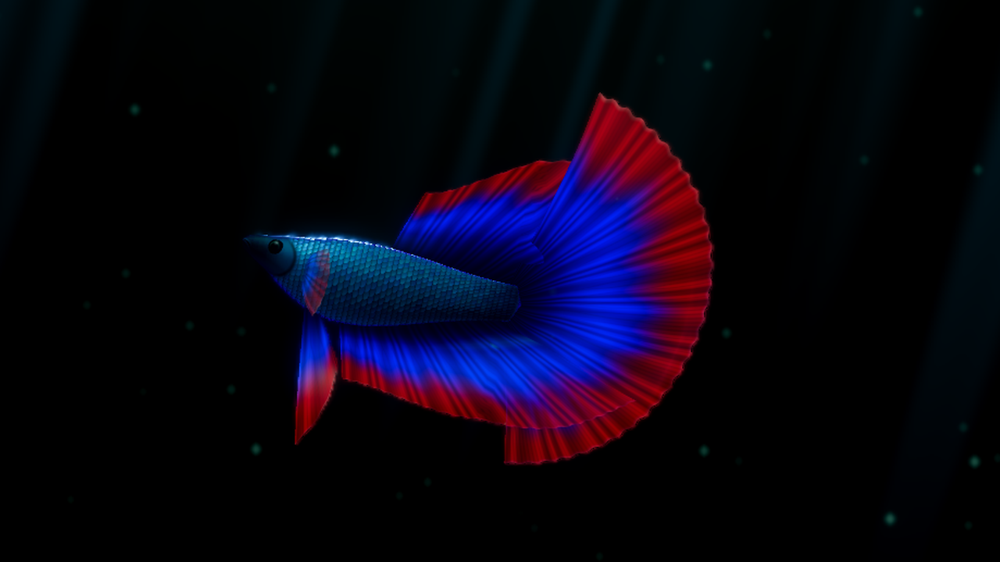
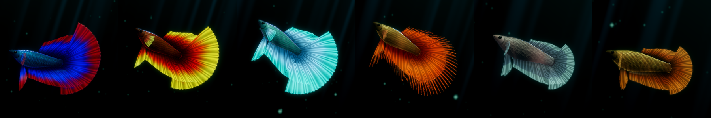

# Bettaquarium

A life-size Siamese fighting fish (*Betta splendens*) swimming in dark water, built in Godot 4.
Everything — the fish, its fins, its colours and the way it moves — is generated in code. There are no models or textures.



## Features

- **Life-size.** The camera distance follows the window size and the screen's pixel density, so the fish is always about 4 cm long on your screen. A bigger window shows more water, not a bigger fish.
- **Procedural fish.** The body is lofted from a hand-tuned profile of a real betta. The fins are ray-structured sheets that fork towards the edge, with scalloped or crowned margins.
- **Shader-driven swimming.** A travelling body wave runs from behind the eyes out to the fin tips. The fins ripple, billow and trail behind the body on springs, so they overshoot and swing when the fish turns or stops.
- **Behaviour.** The fish cruises, hovers and darts. Its eyes move independently and glance around. It breathes with its gill covers.
- **Feeding.** Drop a pellet and the fish notices it, approaches, pauses to aim, then strikes with its mouth opening and chews.
- **Real colour morphs and fin types.** Halfmoon, rosetail, delta, veiltail, crowntail, double tail, plakat and others, in colours such as royal blue, red dragon, mustard gas, koi, butterfly and cellophane. They are combined the way they occur in the hobby.



## Running it

You need [Godot 4.4 or newer](https://godotengine.org/download) (developed on 4.7 with the Forward+ renderer).

```bash
godot --path /path/to/bettaquarium
```

Or open `project.godot` in the Godot editor and press F5.

| Key | Action |
| --- | --- |
| `F` | Drop food |
| `C` | Cycle the preset palettes |
| `2` | Random colour morph and fin type |
| `Cmd+F` / `F11` | Toggle fullscreen |
| `Esc` | Quit |

## How it is built

| File | Contents |
| --- | --- |
| `main.gd` | Scene setup: environment, lights, light shafts, drifting particles, camera, life-size fitting |
| `betta.gd` | Behaviour state machine, steering, feeding, eyes, mouth and gills; drives the shader |
| `betta_mesh.gd` | Procedural body and fin mesh, shaped by a fin-type dictionary |
| `betta_morphs.gd` | Preset palettes, colour morphs and fin types |
| `food.gd` | Food pellet: drops in, floats, sinks, gets eaten |
| `shaders/betta.gdshader` | Body and fin deformation (vertex), scales, fin rays and colour patterns (fragment) |
| `shaders/eye.gdshader` | Eye with a refracting cornea and its own lighting |
| `tools/` | Headless test scenes for feeding and for tracking down flickering pixels |

All motion of the fish happens in the vertex shader. The script only sets a handful of parameters per frame: swim phase and amplitude, body bend, fin drag, mouth and gill opening.
